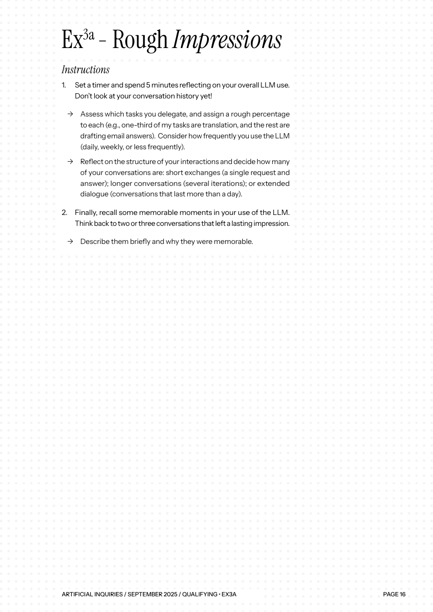
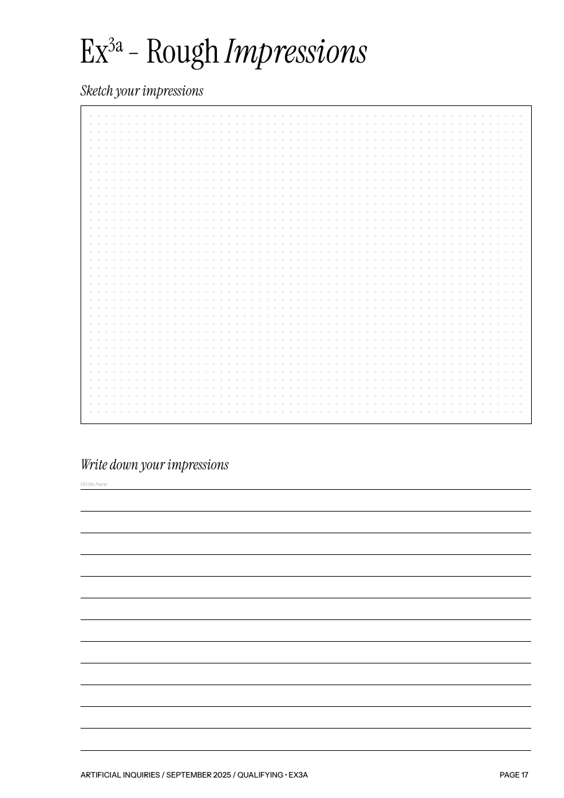

# ArtificialInquiries_3.a — Impressions à chaud

Outil numérique pour l'exercice **Ex3a « Rough Impressions »** du vademecum *Artificial Inquiries*.

> Alcaras, G., Ricci, D., Prinetti, T. & de Vries, Z. (2025). *Artificial Inquiries. A vademecum for workers in the age of AI*. Éditions Annexes, médialab Sciences Po. https://hal.science/hal-05327878

## 1. L'exercice

L'Ex3a ouvre l'exercice 3 « Taking Stock » (faire le point), dans le bloc 01 *Qualifying*. Avant de relire son historique de conversations avec une IA (ChatGPT, Claude, Le Chat…), on note **à chaud**, en 5 minutes, ce que l'on croit savoir de son propre usage.

Consignes du vademecum (pages 16-17) :

1. **Mettre un minuteur de 5 minutes** et réfléchir à son usage global, **sans regarder son historique**.
   - Lister les tâches confiées à l'IA avec un **pourcentage approximatif** pour chacune (ex. : un tiers de traduction, le reste en réponses à des mails).
   - Estimer la **fréquence** d'usage : tous les jours, chaque semaine, moins souvent.
   - Estimer la **structure** des conversations : échanges courts (une question, une réponse), conversations longues (plusieurs allers-retours), dialogues étendus (sur plus d'une journée).
2. **Se souvenir de 2 ou 3 conversations marquantes**, les décrire et dire pourquoi elles ont marqué.
3. **Dessiner** puis **écrire** ses impressions dans les deux cadres prévus.

Ces impressions servent ensuite de point de comparaison avec l'historique réel, dans l'Ex3b « Rolling the Dice ».

### Le formulaire papier

| Consignes (page 16) | Formulaire à remplir (page 17) |
|---|---|
|  |  |

*Copies d'écran du vademecum* Artificial Inquiries *(CC BY-NC).*

## 2. Ce que fait l'outil

| Consigne du vademecum | Fonction dans l'outil |
|---|---|
| Minuteur de 5 minutes | Compte à rebours avec barre de progression, pause et remise à zéro |
| Tâches et pourcentages | Liste de tâches avec curseurs, total contrôlé (100 %), bouton d'ajustement automatique, graphique en anneau |
| Fréquence d'usage | Boutons à choix unique |
| Structure des conversations | Trois curseurs liés (total toujours 100 %) et barre empilée |
| 2 ou 3 conversations marquantes | Trois fiches : titre, description, ressentis (enthousiasme, frustration, amusement, inquiétude, surprise, doute éthique) |
| Cadre « Sketch your impressions » | Zone de dessin à la souris ou au doigt |
| Cadre « Write down your impressions » | Zone de texte libre |
| Garder une trace | Export en Markdown avec métadonnées (YAML), à copier dans Zotero, Obsidian ou un LLM Wiki |

## 3. Solutions techniques

### Version actuelle : page web autonome

- **Un seul fichier** `impressions-a-chaud.html` : HTML, CSS et JavaScript sans framework ni serveur.
- **Graphiques** en CSS pur (`conic-gradient` pour l'anneau, `flex` pour la barre empilée) : aucune bibliothèque.
- **Dessin** avec l'API `<canvas>` et les *Pointer Events* (souris, stylet et tactile).
- **Sauvegarde** dans le navigateur avec `localStorage` : les réponses ne quittent pas l'ordinateur.
- **Export** en Markdown avec en-tête YAML, copié avec l'API `navigator.clipboard`.
- **Thème clair et sombre** automatique (`prefers-color-scheme`).

Pour l'utiliser : ouvrir `impressions-a-chaud.html` dans un navigateur, ou activer **GitHub Pages** sur le dépôt.

### Évolution prévue : stocker les réponses dans Omeka S

Pour rassembler les réponses de plusieurs participants (travail en cohorte, comme le recommande le vademecum), les données peuvent être enregistrées dans **Omeka S** :

- un **modèle de ressource** (*resource template*) « Ex3a – Impressions » reprenant les classes du diagramme (`diagram_class.md`) ;
- chaque session devient un **contenu** (*item*) Omeka S, lié aux tâches et aux conversations marquantes ;
- l'outil envoie les données via l'**API REST d'Omeka S** (`/api/items`, avec une clé d'API) ;
- le croquis est stocké comme **média** (image PNG) attaché au contenu.

Pile technique pour l'installation locale : **Apache + PHP + MySQL** (voir la [documentation d'installation d'Omeka S](https://omeka.org/s/docs/user-manual/install/)).

## 4. Modèle de données

Voir [`diagram_class.md`](diagram_class.md) (diagramme de classes Mermaid).

## 5. Traduction du modèle dans Omeka S (vocabulaire commun)

L'exercice utilise le **vocabulaire commun** du cours, déjà installé dans la base commune [humanum-p8.fr/omk_artificialinquiries](https://humanum-p8.fr/omk_artificialinquiries/admin) :

- préfixe : `artinq`
- espace de noms : `https://humanum-p8.fr/omk_artificialinquiries/onto/artinq#`

### Correspondance diagramme → vocabulaire commun

| Classe du diagramme | Classe commune |
|---|---|
| `Participant` | `artinq:Participant` |
| `SessionImpressions` | `artinq:Passation` (liée à l'item « Exercice 3.a » de `artinq:Exercice`) |
| `TacheDeleguee` | `artinq:Tache` |
| `ConversationMarquante` | `artinq:ConversationMarquante` |
| `Ressenti` | `artinq:Emotion` (un contenu par émotion, réutilisé) |
| `llmPrincipal` | `artinq:LLM` (un contenu par modèle, réutilisé) |

| Attribut ou relation du diagramme | Propriété commune |
|---|---|
| titres | `dcterms:title` |
| `Participant.metier` | `artinq:profession` |
| Session → Exercice 3.a | `artinq:porteSur` |
| Session → Participant | `artinq:realiseePar` |
| `date` | `artinq:date` |
| `llmPrincipal` | `artinq:utiliseLLM` → `artinq:LLM` |
| `frequence`, `dureeMinuteur` | `artinq:frequence`, `artinq:dureeMinuteur` |
| `StructureConversations` (3 parts) | `artinq:partEchangesCourts`, `artinq:partConversationsLongues`, `artinq:partDialoguesEtendus` |
| Session → TacheDeleguee | `artinq:aPourTache` |
| `TacheDeleguee.pourcentage` | `artinq:pourcentage` (+ `artinq:ordre`) |
| Session → ConversationMarquante | `artinq:aPourConversation` |
| `ConversationMarquante.rang` | `artinq:ordre` |
| `ConversationMarquante.description` | `artinq:pourquoiMarquante` |
| `ConversationMarquante.ressentis` | `artinq:aPourEmotion` → `artinq:Emotion` |
| `Impression.texte` | `artinq:texte` |

Le fichier `artificial_inquiries.ttl` est mon premier vocabulaire personnel : il est **remplacé** par le vocabulaire commun.

### Modèles de ressource

Le dossier [`resource-template/`](resource-template/) contient les modèles de ressource, à importer dans la base commune (Modèles de ressource → Importer) :

| Fichier | Libellé | Classe |
|---|---|---|
| `Ex3a_Passation.json` | Ex3a - Passation | `artinq:Passation` |
| `Ex3a_Tache.json` | Ex3a - Tâche | `artinq:Tache` |
| `Ex3a_Conversation_marquante.json` | Ex3a - Conversation marquante | `artinq:ConversationMarquante` |
| `Ex3a_Participant.json` | Ex3a - Participant | `artinq:Participant` |

Les émotions et les LLM utilisent les modèles communs déjà présents dans la base.

### Base de données

`omk.sql` est l'export de mon installation Omeka S locale (premiers tests).

## 6. Interface de gestion (CRUD) : `response.html`

Page HTML-CSS-JavaScript, sans framework, qui gère les réponses de l'exercice directement dans Omeka S.

En ligne (GitHub Pages) : **https://leiticia44.github.io/ArtificialInquiries_3.a/response.html**

### Ce que fait la page

| Action | Ce que fait l'interface | Appel à l'API Omeka S |
|---|---|---|
| **Create** | Nouvelle passation avec participant, LLM, tâches (total 100 %), structure des conversations (total 100 %), 2 ou 3 conversations marquantes (avec émotions) et impressions | `POST /api/items` (un contenu par tâche, par conversation, puis la passation qui les relie) |
| **Read** | Liste des passations de l'exercice 3.a, puis détail | `GET /api/items?resource_template_id=…` et `GET /api/items/{id}` |
| **Update** | Modification d'une passation et de ses tâches et conversations | `PUT /api/items/{id}` (les tâches et conversations retirées sont supprimées) |
| **Delete** | Suppression d'une passation, de ses tâches et de ses conversations (participant, LLM et émotions gardés) | `DELETE /api/items/{id}` |

Par défaut, la page se connecte à la **base commune** (`https://humanum-p8.fr/omk_artificialinquiries/api`) ; on peut aussi choisir l'Omeka local (`http://localhost/omekas/api`). Au démarrage, elle lit les identifiants du vocabulaire commun `artinq` et les modèles « Ex3a - … » (`/api/resource_classes`, `/api/properties`, `/api/resource_templates`) : aucun numéro n'est écrit en dur.

### Authentification

| Méthode | État | Explication |
|---|---|---|
| **Locale (clé API Omeka S)** | ✅ fonctionne | `key_identity` + `key_credential`, créées dans Omeka S (Utilisateurs → Modifier → Clés d'API). Sans clé : lecture seule des contenus publics. |
| **Google** | ✅ identification | Google Identity Services : vérifie le nom et l'e-mail. Il faut un identifiant client Google, avec les origines `https://leiticia44.github.io` et `http://localhost` autorisées. L'écriture dans Omeka demande toujours la clé API. |
| **GitHub** | ⏳ à venir | GitHub OAuth demande un « secret client » qui ne peut pas être dans une page publique : il faut un petit serveur intermédiaire. |
| **CAS (université)** | ⏳ à venir | Se fait côté Omeka S, avec un module d'authentification CAS : on se connecte à Omeka avec son compte Paris 8, puis on crée sa clé API. |

### Autoriser la page à appeler un Omeka local (CORS)

Pour la base commune, c'est le serveur du cours qui autorise les pages GitHub. Pour un Omeka **local**, ajouter ces lignes dans `omekas/index.php`, juste après `use Laminas\View\Model\ViewModel;` :

```php
header('Access-Control-Allow-Origin: *');
header('Access-Control-Allow-Methods: GET, POST, PUT, PATCH, DELETE, OPTIONS');
header('Access-Control-Allow-Headers: Content-Type');
header('Access-Control-Allow-Private-Network: true');
if ($_SERVER['REQUEST_METHOD'] === 'OPTIONS') { http_response_code(204); exit; }
```

Dans Chrome, il faut aussi autoriser « Accès au réseau local » pour la page github.io (Paramètres du site).

## 7. Structure du dépôt

```
ArtificialInquiries_3.a/
├── README.md                  ← ce fichier
├── diagram_class.md           ← diagramme de classes (Mermaid)
├── impressions-a-chaud.html   ← l'outil
├── response.html              ← interface CRUD connectée à Omeka S
├── ex3a_consignes.png         ← consignes papier (p. 16)
├── ex3a_formulaire.png        ← formulaire papier (p. 17)
├── artificial_inquiries.ttl   ← premier vocabulaire (remplacé par le vocabulaire commun)
├── resource-template/         ← modèles de ressource Ex3a (vocabulaire commun, JSON)
└── omk.sql                    ← export de la base Omeka S
```

## Licence

Le vademecum *Artificial Inquiries* est publié sous licence CC BY-NC.
