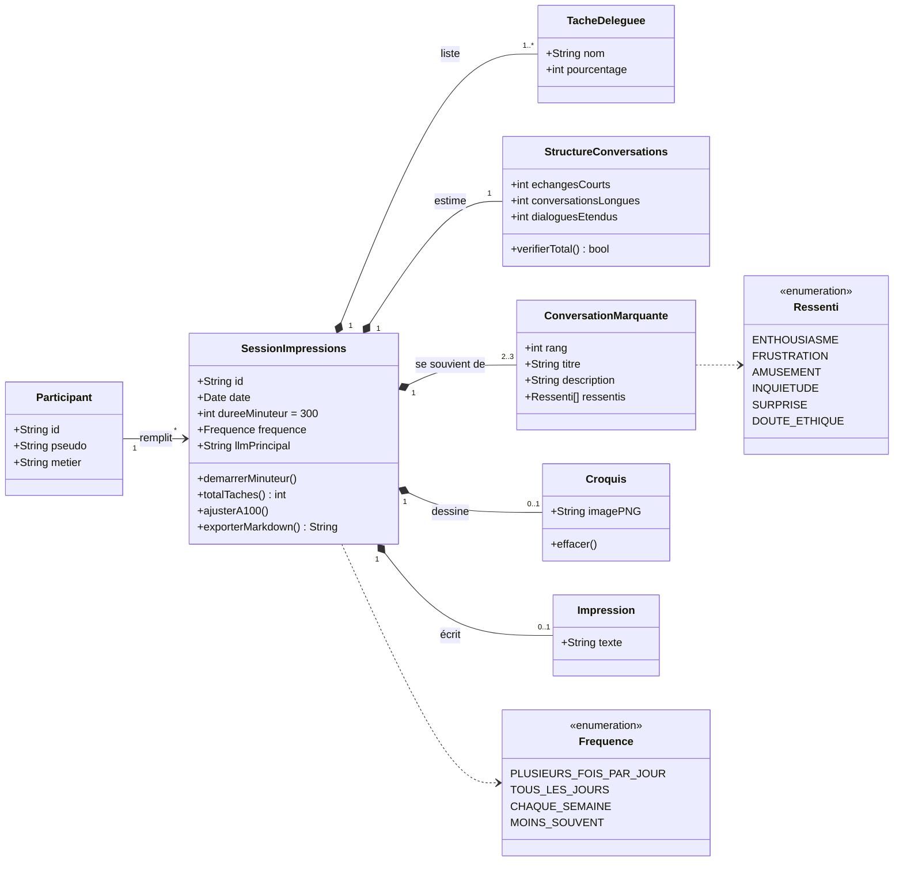

# Diagramme de classes — Ex3a « Rough Impressions »

Modèle des données gérées par l'outil `impressions-a-chaud.html`. À coller dans [mermaid.live](https://mermaid.live/) pour le visualiser (GitHub l'affiche aussi directement).

## Règles

- La somme des `pourcentage` des `TacheDeleguee` d'une session doit faire **100**.
- `echangesCourts + conversationsLongues + dialoguesEtendus = 100`.
- Une session contient **2 ou 3** conversations marquantes (consigne du vademecum).
- `dureeMinuteur` vaut 300 secondes (5 minutes).

## Correspondance avec Omeka S

| Classe | Omeka S |
|---|---|
| `SessionImpressions` | Contenu (*item*) avec le modèle de ressource « Ex3a – Impressions » |
| `TacheDeleguee`, `ConversationMarquante` | Contenus liés à la session (propriété de type *resource*) |
| `Croquis` | Média (image PNG) attaché à la session |
| `Participant` | Contenu de classe `foaf:Person` |
